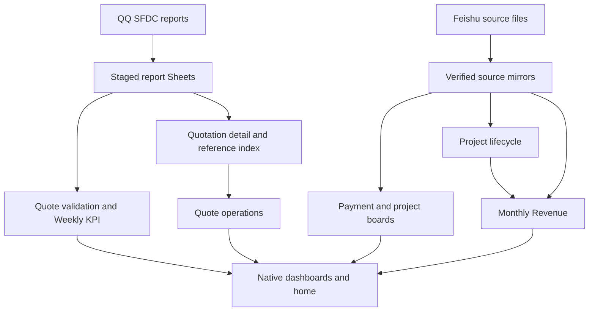

# Sales automation architecture and efficiency

Reviewed against main `64070c00b91244c54033534e89a6220ca8f9c2d0` on 2026-11-24
(Asia/Seoul). The linked workflows and sources are the executable contracts.
This guide covers the Feishu sales automation and its QQ, SFDC, and CSS
dependencies, not unrelated repository areas.

## Data flow and ownership

The two main metric-producing workflows are independently scheduled. Neither
uses `workflow_run` to depend on the other. Mail staging, operational queues,
reference classification, and display refreshes have additional workflows with
their own responsibilities.

The diagram shows orchestration, not every input tab. Existing CSS project and
invoice Sheets also feed the derived calculations. `SFDC Quote Export` is a
separate Quote-header input; the three-report importer does not produce it.

| Layer | Owner and entry point | Contract |
| --- | --- | --- |
| SFDC report staging | [three_report_email_ingest.py](../sfdc/three_report_email_ingest.py) | Preserve source identity, report schema, receipt evidence, and content hashes; unchanged input is not a new report. |
| Quote publication | [sfdc-three-report-email-digestion.yml](../../.github/workflows/sfdc-three-report-email-digestion.yml) | Validate report relationships and expected report-slot freshness before publishing Quote Review and Weekly KPI. `FEISHU_METRIC_SCOPE=quote`. |
| Feishu source mirrors | [project_status_sync.py](project_status_sync.py), followed by [independent parity verification](../ops/css_feishu_post_sync_verify.py) | Source files and manifest must agree with the current mirror before downstream publication. |
| Payment/project publication | `payment` job in [feishu-sources-unified.yml](../../.github/workflows/feishu-sources-unified.yml) | Reconcile payment evidence, publish Project SIF Monitor and Project Progress Board, then update the Payment dashboard. `FEISHU_METRIC_SCOPE=operations`. |
| Lifecycle and Monthly Revenue | `lifecycle` and `monthly` jobs in the unified workflow | Lifecycle enforces no-shrink checks; Monthly waits for ingestion and lifecycle, verifies VAT/source authority, then publishes issued revenue and trends. Payment and lifecycle can run independently after ingestion. |
| QQ mail ledger | [qq-mail-feishu-sync.yml](../../.github/workflows/qq-mail-feishu-sync.yml) and [backfill](../../.github/workflows/qq-mail-2026-backfill.yml) | Ingestion and ledger readback are distinct from downstream sales-table catalog health. Audit separation and its job budget are tracked in [PR #825](https://github.com/kimtk94/Codex/pull/825). |
| Quotation detail and classification | [sfdc_quote_report_bridge.py](sfdc_quote_report_bridge.py), [sfdc_quote_reference_preindex.py](sfdc_quote_reference_preindex.py) | Raw report, ingest audit, and Quote Export are validated together. Audit, sync, and reference phases each re-read their own evidence. |
| Home and dashboards | [sales_native_home.py](sales_native_home.py), [sales_native_trends.py](sales_native_trends.py), native dashboard scripts | Present validated derived data. A display refresh does not certify upstream ingestion. |

The standalone Quotation mirror verifies receipt/hash integrity and rejects
future or regressing evidence. The latest 09/12/17 report-slot requirement belongs
to the SFDC pipeline's freshness guard. Mirror success alone does not certify
current CRM state or a newly delivered report.

Several useful optimizations already exist: report mail is filtered by headers
before full MIME reads, unchanged staging is skipped by receipt/hash, mail
evidence phases reuse a completed snapshot within the same job, and derived
writers skip unchanged values. This change preserves those boundaries.

### Record scope is narrower than schema scope

`sales_metrics_sync.py` supports `quote`, `operations`, and `all` record scopes.
The automatic writers use the first two; Monthly Revenue has a separate
publication path. Record-scope disjointness is covered by
[test_sales_metrics_scope.py](test_sales_metrics_scope.py).

The shared metrics reader currently fetches all 21 configured source tabs for
every scope. Mandatory-source checks also span Quote, project, and invoice
sources. `ensure_tables()` and `setup_views()` validate all five metric tables
and their managed views regardless of record scope. Record ownership is
separated, but reads and schema maintenance are still coupled. Reducing those
scopes requires explicit source-contract tests.

### Human input and stable identifiers

Derived writers compare existing values before updating source-owned fields.
Manual Quote Review exclusions and independently verified payment evidence have
preservation checks. Those fields must not be overwritten to simplify sync.

Table and view IDs are referenced by links and native components. Sidebar moves
preserve identity; deleting and recreating a managed view does not.
`setup_views()` can recreate missing managed views. The default `All` view is
created only with a new table and is not required for existing metric tables.
The home shortcut view has a fixed-identity guard in
[sales_native_home.py](sales_native_home.py).

## Execution and freshness

| Workflow family | Declared cadence or trigger | Meaning |
| --- | --- | --- |
| Sources Payment Online Monthly Unified | Every three hours, minute 25 | Ingest, then Payment and lifecycle; Monthly depends on ingest and lifecycle. |
| SFDC Three Report Mail Digestion | Three primary and five recovery slots daily | Primary slots are 09:50, 12:50, and 17:50 KST. The report freshness guard decides whether publication is valid. |
| QQ Mail Feishu Sync | Minutes 13 and 43 hourly | Incremental mailbox ingestion. Backfill is a separate recovery path. |
| Native presentation and auxiliary integrations | Per-workflow schedules and upstream events | Each has source/display obligations; absence of a cron alone does not mean a workflow is unused. |

Schedules are configuration, not proof of dispatch or source arrival. Inspect
the run event, live job execution, source evidence, and sink readback. PR
success, skipped publication, and the last successful run answer different
questions. The Actions workflow-registry endpoint was unavailable through the
connector during this review; this guide does not assert that every declared
schedule is administratively enabled.

### Execution locks

Production workflows that share a writer retain their existing concurrency
groups, including `qq-feishu-mail-ingest`, `sales-weekly-writer`, and
`isolated-lead-feishu-mail-description`. Production work is not canceled by the
new PR cancellation policy.

The 20 reviewed Feishu-related workflows that previously put PR tests into a
fixed production group now assign PRs a key containing workflow identity and PR
number. Only superseded runs of the same PR/workflow may cancel one another.
PR validation in these workflows can no longer occupy or replace a pending
production slot. Workflows that already isolated PRs keep their existing policy.

GitHub's default `queue: single` permits one pending run per group; a newer run
replaces the pending run even when `cancel-in-progress` is false. Changing to
`queue: max` is a separate operational choice, outside this change.
See [GitHub's concurrency reference](https://docs.github.com/en/actions/reference/workflows-and-actions/workflow-syntax#concurrency).

## Bounded efficiency improvements

| Change | Before | After | Verification retained |
| --- | --- | --- | --- |
| Stable metrics schema/view maintenance | 61 metadata requests | 42 metadata requests | All five schemas, each managed view's properties, mutation readbacks, and final view identity checks. |
| Quotation detail mirror sequence | 9 Sheets reads across audit, sync, and reference phases | 3 reads | Each phase independently reads all three ranges and applies receipt, hash, schema, and sink checks. |
| PR/production execution queues | 20 workflows shared their production groups with PR validation | PR keys separated from production groups | Production groups, triggers, permissions, and live-write gates. |

Request counts assume an unchanged schema, one-page metadata lists, and no
retries. Pagination, creation, drift repair, and transient failures add calls.
These are reproducible request-count reductions, not measured production latency
or GitHub billing savings.

Metrics reuse responses only within one invocation. Schema/formatter writes
still require verification. View properties are read individually; a final
catalog check detects changed names/IDs or duplicates before returning. There
is no persistent cache.

The Quotation reader uses
[Sheets values.batchGet](https://developers.google.com/workspace/sheets/api/reference/rest/v4/spreadsheets.values/batchGet)
to combine ranges from the same spreadsheet. Response identity, range order,
and bounds are checked. A batch read does not establish a transactionally atomic
snapshot; evidence is not shared across audit, sync, and reference phases.

## Follow-up work and acceptance criteria

| Priority | Finding | Next change and acceptance criterion |
| --- | --- | --- |
| 1 | Each metric scope still reads 21 tabs and maintains all metric schemas. | Define per-scope source/schema contracts, then remove cross-scope requests. Quote publication must require Quote proof without depending on unrelated Revenue availability. Preserve all financial checks in operations/monthly paths. |
| 2 | Six read-only probes declare 30-minute cadences: up to 288 scheduled starts daily before skips or dispatch delays. | Classify ongoing health checks versus setup diagnostics; agree detection intervals and consolidate overlap. Retain an owner and observable failure signal for each removed trigger. |
| 3 | Run History receives requested, in-progress, and completed events from both main workflows, plus a 30-minute schedule. | Decide whether live progress is required. Consider completed-event updates plus slower reconciliation, with coverage for missed events and failed/skipped runs. |
| 4 | The SFDC chain deliberately waits 75 seconds for shared Sheets quota. | Measure 429 rates and stage durations after request reductions. Replace the fixed wait only when quota behavior and bounded retries justify it. |
| 5 | Standalone mirror/display workflows overlap portions of main pipelines. | Document freshness and recovery obligations first. Remove a duplicate trigger only when its owner, shared lock, and recovery are covered by the retained path. |

The six probes counted are `feishu-base-readonly.yml`,
`feishu-base-three-tables.yml`, `feishu-two-sheets-readonly.yml`,
`feishu-sheets-discovery.yml`, `feishu-latest-four.yml`, and
`feishu-latest-four-schema.yml`. Counts come from configuration, not observed
daily execution totals.

Seven legacy standalone writers intentionally lack `schedule` and
`workflow_run`: sales metrics, canonical monthly revenue, online project TAT,
project sync, payment reconciliation, native sales trends, and native Payment
dashboard. [test_unified_workflow_contracts.py](test_unified_workflow_contracts.py)
requires that ownership boundary and reads those files. They remain deliberate
recovery tools; deleting files without replacing the contract breaks validation.

## Verification and rollout

Run focused metadata, source-batch, scope-ownership, and workflow-concurrency
tests offline. Fixtures use synthetic records and mocked HTTP clients; they do
not invoke live sync entry points with credentials.

Review and merge through the normal PR process. After merge, compare request and
retry counts, stage timings, and source/sink success evidence on normal scheduled
runs. Offline success does not prove recovery of an unrelated production
freshness or permission issue.

The separate [read-throttling/schema fix in PR #1043](https://github.com/kimtk94/Codex/pull/1043)
and [mail audit/job-budget fix in PR #825](https://github.com/kimtk94/Codex/pull/825)
address earlier failures. This change must stay compatible with both; it does
not claim either is already deployed.
